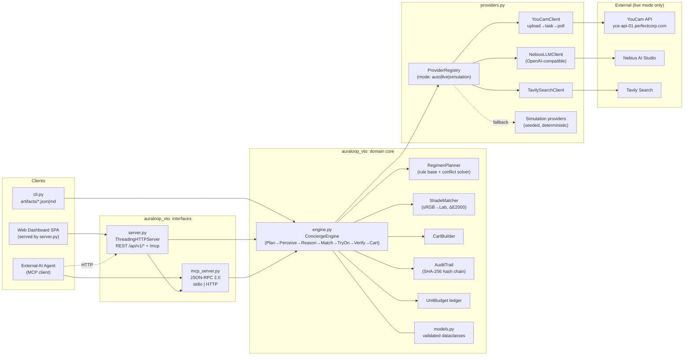

# AuraLoop VTO: Architecture & Implementation Design Specification

> **Document:** `DESIGN_OPUS55.md`
> **Project:** AuraLoop VTO, an agentic Skin AI diagnostics and real-time omnichannel Virtual Try-On concierge
> **Python package:** `auraloop_vto`
> **Hackathon:** YouCam API: Skin AI & eCommerce VTO Hackathon (Perfect Corp. × Devpost)
> **Target:** Skin AI + eCommerce VTO combined experience, competing for 1st ($2,500), 2nd ($1,000) and 3rd ($500) place
> **Author:** Kazutoshi Hayashi (`cal29292929`)
> **License:** MIT
> **Status:** Implementation-ready design, v1.0 (2026-10-27)

---

## 0. Deadline & Schedule

> ⚠️ **The deadlines don't match.** The project brief gives **2026-11-01 12:45 JST**. The official Devpost deadline is **Nov 2, 2026 @ 11:45 am EST**. US DST ends on Nov 1, 2026, so that time is UTC−5, which is **2026-11-02 16:45 UTC = 2026-11-03 01:45 JST**.
>
> **Plan:** we treat the earlier brief date (**2026-11-01 12:45 JST**) as the **internal code-freeze**. That leaves about 37 hours of buffer before the official cutoff for the video, screenshots and Devpost form. We do not plan to use that buffer for code.

| Date (JST) | Milestone | Exit criterion |
|---|---|---|
| Oct 27 | Spec frozen (this doc) and repo skeleton | `python -m unittest` passes on the skeleton |
| Oct 28 | `models.py` and `providers.py` (simulation + live) | Simulation suite runs in under 5 s; one live skin-analysis call recorded to a fixture |
| Oct 29 | `engine.py` agentic loop and audit chain | End-to-end `concierge` run works in both modes |
| Oct 30 | `server.py` dashboard and `mcp_server.py` | Dashboard flow works on desktop and mobile Safari/Chrome |
| Oct 31 | Hardening: security tests, unit-budget guard, README | All tests green; live smoke run uses ≤ 40 units |
| **Nov 1 12:45** | **Internal code freeze** | Tag `v1.0.0` |
| Nov 1–2 | Demo video (≤ 3 min), screenshots, Devpost text | Submitted before **Nov 3 01:45 JST** |

---

## 1. Executive Summary

**The problem.** Shoppers ask about their skin at specific moments: just before a purchase, right after a breakout, or in front of a mirror wondering whether a product is working (this framing comes straight from the hackathon brief). Today these moments are handled by separate tools. A skin scanner returns scores with no next step. A makeup VTO ignores what the skin actually needs. An apparel VTO ignores the face entirely. The cart doesn't know about any of them. As a result, shoppers buy the wrong shades, return products, and lose trust in the brand.

**What AuraLoop does.** An agentic concierge closes that loop in one session:

1. **Perceive:** YouCam AI Skin Analysis produces 14 cosmetic skin metrics and an optional skin-tone/undertone reading.
2. **Reason:** a deterministic regimen engine (with optional LLM narration) turns the metrics into a prioritized, conflict-free AM/PM routine.
3. **Match:** a CIELAB ΔE2000 shade matcher, made aware of the user's concerns, selects foundation, concealer, lip shades and apparel colors that work with the complexion.
4. **Try on:** YouCam Makeup VTO and YouCam Apparel VTO are **chained**. The makeup result becomes the input to the apparel try-on, so the user sees one coherent full look rather than two disconnected previews.
5. **Commit:** a cart is assembled with an explanation attached to each line item ("why this SKU").
6. **Loop:** an opt-in re-scan compares metric deltas over 14 or 28 days to answer "is this product working?" Only scores are stored, on the user's device. No images are stored anywhere.

**Why it is credible to judges:**

- **Two execution modes.** Live YouCam/Nebius/Tavily mode when keys exist. Otherwise a **deterministic, high-fidelity simulation** that runs the whole experience in **under 5 seconds with no setup** (`python -m auraloop_vto.cli demo`).
- **MCP server.** Any AI agent (Claude Desktop, IDE agents) can call `analyze_skin`, `match_shade`, `virtual_try_on`, `build_cart` and `run_concierge` over JSON-RPC 2.0.
- **Standard library only at runtime.** No pip install is needed to judge the project. Tests use `unittest`.
- **Privacy-first.** Face images are processed in memory, EXIF is stripped, images are never written to disk or logs, and the audit trail is hash-chained and contains no PII.

---

## 2. Judging Criteria & Prize Track Alignment

### 2.1 Official criteria → system features

| Official criterion | What judges look for | Concrete AuraLoop features (with evidence) |
|---|---|---|
| **Technological Implementation** | Thorough, skillful YouCam integration; non-trivial working code | • **Three YouCam capabilities chained**: Skin Analysis → Makeup VTO → Apparel VTO (§4.3)<br>• Full upload → task → poll lifecycle with idempotency-safe retries (§6.3)<br>• Unit-budget ledger that caps spend (§6.5)<br>• MCP JSON-RPC 2.0 server (§8)<br>• About 120 unit tests, including recorded live-response fixtures (§11) |
| **Design** | A complete, coherent product, not a proof of concept | • Five-step single-page flow: *Scan → Understand → Match → Try On → Checkout*<br>• "Why this product" explanation on every recommendation<br>• Visible **LIVE / SIMULATED** badge on every result (honest UX)<br>• Mobile-first camera capture with framing guidance and quality gating |
| **Potential Impact** | A specific problem for a specific audience, and evidence the solution addresses it | • Audience: online beauty shoppers who buy without testing products (shade mismatch is a common reason for beauty returns)<br>• KPI instrumentation in the demo: ΔE00 match quality, concern coverage %, cart coherence score<br>• Retailer value: an embeddable REST/MCP surface that a store can add to an existing PDP or chat agent |
| **Quality of Idea** | Creative, non-obvious API use; real understanding of the domain | • **Skin-state-conditioned VTO**: makeup finish and coverage come from diagnostics (oily → matte, dehydrated → dewy, redness → green-correcting primer)<br>• **Complexion-harmonious apparel**: garment colors chosen by Lab contrast against the measured skin tone<br>• **"Is it working?" loop**: longitudinal deltas without storing images<br>• Ingredient conflict resolution (e.g., retinoid vs. AHA on the same night) |

### 2.2 Prize tracks

| Track | Eligibility / fit | Strategy |
|---|---|---|
| 1st / 2nd / 3rd Place | Open to all valid submissions | Primary target. One build covers both hackathon themes (Skin AI and eCommerce VTO) in a single combined experience. |
| Women in Tech Special Award | Depends on team composition | Not targeted by this design. Eligibility is set by the entrant's own profile. |
| Rising Star (Student only) | Depends on student status | Not targeted by this design. |
| Share & Earn bonus | Sharing the project online | Optional post-submission step; extra units fund more live demo runs. |

### 2.3 Submission checklist (from the official requirements)

- [ ] Public repository with MIT `LICENSE`, all source, assets and a `README.md` with run instructions
- [ ] Text description of features, functionality and consumer/retail value
- [ ] Screenshots in `docs/screenshots/` (dashboard steps 1–5, MCP tool call, CLI artifact)
- [ ] Demo video of 1–3 minutes on YouTube (public) that **names the YouCam APIs used**, shows the product running on the target device, and uses no third-party trademarks or copyrighted music
- [ ] Availability for an exit interview and the blog feature if selected

---

## 3. System Architecture

### 3.1 Component diagram



### 3.2 Layering rules

| Layer | May import | Must not import |
|---|---|---|
| `models.py` | stdlib only | anything else in the package |
| `providers.py` | `models` | `engine`, `server`, `mcp_server` |
| `engine.py` | `models`, `providers` | `server`, `mcp_server`, `cli` |
| `mcp_server.py` | `engine`, `models` | `server` |
| `server.py` | `engine`, `models`, `mcp_server` | — |
| `cli.py` | everything | — |

The test `tests/test_architecture.py` parses imports with `ast` and fails the build if any of these rules is broken.

### 3.3 End-to-end agentic sequence

```mermaid
sequenceDiagram
    autonumber
    participant U as User (SPA)
    participant S as server.py
    participant E as ConciergeEngine
    participant P as ProviderRegistry
    participant Y as YouCam API
    participant A as AuditTrail

    U->>S: POST /api/v1/concierge {image_b64, goals, budget, consent:true}
    S->>S: validate size/MIME, strip EXIF, rate-limit
    S->>E: run_concierge(ConciergeRequest)
    E->>A: append(plan)
    E->>P: skin.analyze(image)
    P->>Y: POST file/skin-analysis → PUT upload URL → POST task → GET poll
    Y-->>P: per-concern scores
    P-->>E: SkinReport (14 metrics, mode=live)
    E->>A: append(perceive)
    E->>E: RegimenPlanner.plan(report, goals)
    E->>E: ShadeMatcher.match(tone, concerns, catalog)
    E->>A: append(reason, match)
    E->>P: vto.makeup(image, LookSpec)
    P->>Y: makeup VTO task
    Y-->>P: result image URL
    E->>P: vto.apparel(makeup_result, GarmentSpec)
    P->>Y: apparel VTO task
    Y-->>P: full-look image URL
    E->>E: verify(): coherence + budget + safety
    E->>E: CartBuilder.build()
    E->>A: append(tryon, verify, cart) → head_hash
    E-->>S: ConciergeResult
    S-->>U: 200 {report, regimen, matches, look, cart, audit_head, mode}
    Note over S: image bytes dereferenced; never written to disk
```

### 3.4 Execution modes

| Mode | Trigger | Behaviour |
|---|---|---|
| **A. Live** | `AURALOOP_MODE=live`, or `auto` with `YOUCAM_API_KEY` set | Real YouCam calls. Nebius LLM handles narration and planning if `NEBIUS_API_KEY` is set. Tavily handles ingredient/product evidence if `TAVILY_API_KEY` is set. |
| **B. Simulation** | `AURALOOP_MODE=simulation`, or `auto` with no YouCam key | Seeded deterministic providers with realistic distributions, latencies drawn from a virtual clock (no real sleeping), and synthesized try-on previews. |
| **Degraded** (auto only) | A live provider fails after retries, or the unit budget is exhausted | That single step falls back to simulation. The result carries `mode="simulation"` and `degraded_reason`, and the UI shows an amber **SIMULATED (fallback)** badge. |

**Per-provider resolution.** Each of `skin`, `vto`, `llm` and `search` resolves its mode independently. For example, live YouCam can run alongside simulated LLM narration. A response is never labelled LIVE unless the bytes actually came from the live API.

**Simulation performance budget.** The full test suite and `cli demo` must run in **under 5 s** on a 2-vCPU CI runner. To achieve this:
- Virtual clock injection: `Clock` protocol, with `FakeClock.sleep()` advancing time instantly.
- No network access. `socket.socket` is patched to raise in simulation tests, which guarantees zero network.
- Preview images are produced as SVG composites, not raster processing.

---

## 4. External API Contracts

> **Source of truth:** https://docs.perfectcorp.com/develop/introduction and the API Playground.
> The endpoint paths below are the adapter's **defaults**, as understood when this spec was written. They live in a single `ENDPOINTS` table in `providers.py` and can be overridden through `AURALOOP_YOUCAM_ENDPOINTS_JSON`, so an API version change is a configuration edit rather than a code change. **Day-1 task:** verify every path, every action name and the per-call unit cost in the Playground, then record one response per feature into `tests/fixtures/youcam/*.json`.

### 4.1 Common YouCam pattern: upload → task → poll

```
Phase 1  POST {base}/s2s/v1.1/file/{feature}
         Authorization: Bearer ${YOUCAM_API_KEY}
         {"files":[{"content_type":"image/jpeg","file_name":"face.jpg","file_size":183422}]}
      →  200 {"status":200,"result":{"files":[{"file_id":"...","requests":[{"method":"PUT","url":"https://...presigned...","headers":{...}}]}]}}

Phase 2  PUT  <presigned url>   (raw image bytes, headers echoed from phase 1)
      →  200

Phase 3  POST {base}/s2s/v1.0/task/{feature}
         {"request_id": <int>, "payload": {"file_sets":{"src_ids":["<file_id>"]}, "actions":[...] }}
      →  200 {"status":200,"result":{"task_id":"..."}}

Phase 4  GET  {base}/s2s/v1.0/task/{feature}?task_id=...     (poll; or v2 path form /task/{feature}/{task_id})
      →  200 {"status":200,"result":{"status":"processing"|"success"|"error", "results":{...}}}
```

Default `ENDPOINTS` map (configurable):

| Key | Feature slug (default) | Used for |
|---|---|---|
| `skin_analysis` | `skin-analysis` | 14-metric skin scoring |
| `skin_tone` | `skin-tone-analysis` | Skin tone and undertone (optional; falls back to Lab estimate) |
| `makeup_vto` | `makeup-vto` | Foundation, lip, blush, brow, eyeliner rendering |
| `apparel_vto` | `cloth` | Garment try-on |

### 4.2 Skin Analysis: canonical metric set (14)

The adapter maps YouCam concern actions to AuraLoop's canonical names. YouCam's per-concern "UI score" is normalized to **0–100 where higher means healthier**. Raw scores are kept in `raw` for traceability.

| # | Canonical metric | YouCam action (SD / HD default) | Higher score means |
|---|---|---|---|
| 1 | `moisture` | `moisture` / `hd_moisture` | better hydrated |
| 2 | `oiliness` | `oiliness` / `hd_oiliness` | less excess sebum |
| 3 | `acne` | `acne` / `hd_acne` | fewer blemishes |
| 4 | `wrinkles` | `wrinkle` / `hd_wrinkle` | fewer or shallower lines |
| 5 | `pores` | `pore` / `hd_pore` | less visible pores |
| 6 | `redness` | `redness` / `hd_redness` | less redness |
| 7 | `dark_spots` | `age_spot` / `hd_age_spot` | fewer spots |
| 8 | `radiance` | `radiance` / `hd_radiance` | more luminous |
| 9 | `texture` | `texture` / `hd_texture` | smoother |
| 10 | `firmness` | `firmness` / `hd_firmness` | firmer |
| 11 | `dark_circles` | `dark_circle_v2` / `hd_dark_circle` | lighter under-eye |
| 12 | `eye_bags` | `eye_bag` / `hd_eye_bag` | less puffiness |
| 13 | `droopy_upper_eyelid` | `droopy_upper_eyelid` / `hd_droopy_upper_eyelid` | less droop |
| 14 | `droopy_lower_eyelid` | `droopy_lower_eyelid` / `hd_droopy_lower_eyelid` | less droop |

> **Domain honesty:** these are **cosmetic appearance scores, not a medical diagnosis.** The UI and the API responses carry a fixed disclaimer. The regimen engine adds a "consider a dermatologist" advisory when `acne < 30` or `redness < 25` (thresholds are configurable).

### 4.3 Chained VTO request contracts (AuraLoop → YouCam adapter)

```jsonc
// LookSpec → makeup VTO payload (adapter-built)
{
  "payload": {
    "file_sets": {"src_ids": ["<face_file_id>"]},
    "actions": [{
      "id": 0,
      "params": {
        "makeup": [
          {"category": "foundation", "color": "#C99A7E", "intensity": 55, "finish": "matte"},
          {"category": "lip",        "color": "#A8434F", "intensity": 70, "texture": "satin"},
          {"category": "blush",      "color": "#D9837A", "intensity": 35}
        ]
      }
    }]
  }
}
```

```jsonc
// GarmentSpec → apparel VTO payload; input is the *makeup result*, which gives one coherent look
{
  "payload": {
    "file_sets": {"src_ids": ["<makeup_result_file_id>"], "ref_ids": ["<garment_file_id>"]},
    "actions": [{"id": 0, "params": {"garment_category": "upper_body", "color_hint": "#2F4A6D"}}]
  }
}
```

If the API cannot take a result URL directly as a new source, the adapter downloads the makeup result **into memory** and re-uploads it through Phase 1–2. The bytes never touch disk.

### 4.4 Auxiliary providers

| Provider | Env key | Endpoint | Purpose | If absent |
|---|---|---|---|---|
| Nebius AI Studio | `NEBIUS_API_KEY` | `POST https://api.studio.nebius.com/v1/chat/completions` (OpenAI-compatible) | Natural-language "why" narration; JSON-schema-constrained plan proposal | Template-based narration (deterministic) |
| Tavily | `TAVILY_API_KEY` | `POST https://api.tavily.com/search` | Evidence snippets for ingredient claims (cited in the UI) | Bundled curated evidence table |

**Guardrail:** the LLM **never** decides prices, cart totals, shade ΔE or safety advisories. It can only re-order or explain options that the deterministic engine has already produced. Its output is validated against a JSON Schema, and anything that fails validation is discarded with an audit entry `llm_output_rejected`.

---

## 5. `auraloop_vto/models.py`: Domain Models

### 5.1 Principles

- `@dataclass(frozen=True, slots=True)` everywhere, which makes models immutable and hashable.
- Validation runs in `__post_init__` and raises `ValidationError(field, reason)`, which is a subclass of `ValueError`.
- `to_dict()` / `from_dict()` use canonical JSON (`sort_keys=True, separators=(",",":")`) so that audit hashes are stable.
- No model field can hold image bytes, except the transient `ImageInput`, which has no `to_dict`.

### 5.2 Core types

```python
METRICS: tuple[str, ...] = (
    "moisture","oiliness","acne","wrinkles","pores","redness","dark_spots",
    "radiance","texture","firmness","dark_circles","eye_bags",
    "droopy_upper_eyelid","droopy_lower_eyelid",
)

class Mode(str, Enum):        LIVE="live"; SIMULATION="simulation"
class Undertone(str, Enum):   WARM="warm"; COOL="cool"; NEUTRAL="neutral"; OLIVE="olive"
class Severity(str, Enum):    NONE="none"; MILD="mild"; MODERATE="moderate"; PRONOUNCED="pronounced"

@dataclass(frozen=True, slots=True)
class ImageInput:                       # transient; never serialized
    data: bytes; mime: str              # image/jpeg | image/png only
    def __post_init__(self): ...        # magic-byte check, 32 px ≤ side, size ≤ 8 MiB
    @property
    def fingerprint(self) -> str: ...   # HMAC-SHA256 with per-process ephemeral key

@dataclass(frozen=True, slots=True)
class MetricScore:
    name: str; score: float; confidence: float = 1.0; raw: float | None = None
    # name ∈ METRICS; 0 ≤ score ≤ 100; 0 ≤ confidence ≤ 1
    @property
    def severity(self) -> Severity: ...  # ≥75 none, ≥55 mild, ≥35 moderate, else pronounced

@dataclass(frozen=True, slots=True)
class SkinTone:
    lab: tuple[float, float, float]      # CIELAB D65
    hex: str                             # "#RRGGBB"
    undertone: Undertone
    ita_deg: float                       # Individual Typology Angle = atan((L-50)/b)·180/π

@dataclass(frozen=True, slots=True)
class SkinReport:
    metrics: tuple[MetricScore, ...]     # exactly 14, unique, ordered as METRICS
    tone: SkinTone
    mode: Mode
    provider: str                        # "youcam" | "simulation"
    skin_health_index: float             # derived (§7.3)
    degraded_reason: str | None = None
    disclaimer: str = COSMETIC_DISCLAIMER

@dataclass(frozen=True, slots=True)
class RegimenStep:
    slot: str            # "AM" | "PM"
    order: int
    category: str        # cleanser | treatment | serum | moisturizer | spf | ...
    ingredient: str      # "niacinamide 5%"
    targets: tuple[str, ...]
    rationale: str
    evidence: tuple[str, ...] = ()       # citation URLs or curated IDs

@dataclass(frozen=True, slots=True)
class Regimen:
    steps: tuple[RegimenStep, ...]
    conflicts_resolved: tuple[str, ...]
    advisories: tuple[str, ...]

@dataclass(frozen=True, slots=True)
class Product:
    sku: str; name: str; category: str; price_minor: int; currency: str  # ISO-4217
    hex: str | None = None; finish: str | None = None
    tags: frozenset[str] = frozenset()   # non_comedogenic, fragrance_free, ...

@dataclass(frozen=True, slots=True)
class ShadeMatch:
    product: Product; delta_e00: float; undertone_ok: bool
    score: float                         # 0–100, higher is better
    reasons: tuple[str, ...]

@dataclass(frozen=True, slots=True)
class LookSpec:      makeup: tuple[dict, ...]; garment: dict | None
@dataclass(frozen=True, slots=True)
class TryOnResult:   image_ref: str; mode: Mode; steps: tuple[str, ...]; coherence: float

@dataclass(frozen=True, slots=True)
class CartLine:      product: Product; qty: int; why: str
@dataclass(frozen=True, slots=True)
class Cart:
    lines: tuple[CartLine, ...]; subtotal_minor: int; currency: str
    checkout_url: str | None             # mock or sandbox; never real payment

@dataclass(frozen=True, slots=True)
class AuditEvent:
    seq: int; ts: str; step: str; tool: str; mode: str
    input_digest: str; output_digest: str
    latency_ms: float; units: int; prev_hash: str; hash: str

@dataclass(frozen=True, slots=True)
class ConciergeRequest:
    image: ImageInput; consent: bool; goals: tuple[str, ...] = ()
    budget_minor: int | None = None; currency: str = "USD"
    garment_category: str | None = "upper_body"; locale: str = "en"
    # consent must be True; goals ⊆ ALLOWED_GOALS; len(goals) ≤ 5

@dataclass(frozen=True, slots=True)
class ConciergeResult:
    session_id: str; report: SkinReport; regimen: Regimen
    shade_matches: tuple[ShadeMatch, ...]; look: TryOnResult; cart: Cart
    narration: str; audit_head: str; metrics: dict[str, float]
```

### 5.3 Validation rules (excerpt)

| Field | Rule | Error |
|---|---|---|
| `ImageInput.data` | JPEG `FF D8 FF` or PNG `89 50 4E 47` magic bytes; ≤ 8 MiB | `invalid_image` |
| `MetricScore.score` | finite and within [0, 100] (NaN/Inf rejected) | `out_of_range` |
| `SkinReport.metrics` | set equals `METRICS`, with no duplicates | `metric_set_mismatch` |
| `Product.hex` | `^#[0-9A-Fa-f]{6}$` | `invalid_hex` |
| `Product.price_minor` | int ≥ 0 (integer minor units, no floats) | `invalid_price` |
| `ConciergeRequest.consent` | `is True` | `consent_required` |
| any `str` | ≤ 512 chars, no control characters except `\n` | `invalid_text` |

---

## 6. `auraloop_vto/providers.py`: Provider Layer

### 6.1 Interfaces

```python
class SkinProvider(Protocol):
    name: str; mode: Mode
    def analyze(self, image: ImageInput) -> SkinReport: ...

class VTOProvider(Protocol):
    def makeup(self, image: ImageInput, look: LookSpec) -> TryOnArtifact: ...
    def apparel(self, source: TryOnArtifact | ImageInput, garment: dict) -> TryOnArtifact: ...

class LLMProvider(Protocol):
    def complete_json(self, system: str, user: str, schema: dict) -> dict: ...

class SearchProvider(Protocol):
    def evidence(self, query: str, max_results: int = 3) -> list[dict]: ...
```

`ProviderRegistry.from_env(env: Mapping[str, str], clock: Clock) -> ProviderRegistry` builds the providers. Configuration comes **only** from the mapping passed in. Nothing reads `os.environ` directly; `cli.py`/`server.py` load `.env` and pass it down, which keeps tests hermetic.

### 6.2 Authentication strategies

| Strategy | Used for | Mechanics |
|---|---|---|
| `BearerAuth` | YouCam (current API-key scheme), Nebius, Tavily | `Authorization: Bearer <key>` |
| `LegacyS2SAuth` (optional) | YouCam accounts on the older client-id/token flow | Exchanges credentials for an `access_token` per the docs and caches it until `expires_in − 60s`. Enabled only if `YOUCAM_CLIENT_ID` + `YOUCAM_CLIENT_SECRET` are set. |
| `HmacAuth` | **Inbound** requests to AuraLoop's own API (retailer embed / webhook) | `X-Auralopp-Signature: t=<unix>,v1=<hex(HMAC_SHA256(secret, t + "." + body))>`, ±300 s skew window, constant-time compare (`hmac.compare_digest`) |

### 6.3 HTTP client: retries, timeouts, idempotency

The transport is built on `urllib.request` with an injectable `Transport` so that tests never touch sockets.

| Concern | Policy |
|---|---|
| Timeouts | connect + read 10 s per request; overall step deadline 60 s (virtual clock in simulation) |
| Retry triggers | `429`, `500`, `502`, `503`, `504`, `URLError`, `TimeoutError` |
| Backoff | full jitter: `sleep = rand(0, min(8, 0.5·2^attempt))`, max 4 attempts; seeded RNG in tests |
| `Retry-After` | honoured (seconds or HTTP-date), capped at 30 s |
| **Unit-safety** | **Task-creation POSTs are not retried after the server has received the body**, because a retry could create a duplicate task and spend units twice. They are retried only on connect-phase failures. Polling GETs and presigned PUTs are always retried. |
| Polling | starts at 1 s, ×1.5 each round, capped at 5 s, deadline 60 s; terminal states `success` / `error` |
| Errors | `ProviderError(code, http_status, retryable, provider)` → engine fallback decision |
| Logging | method, path template, status and latency only. **Never** headers, bodies, presigned URLs or keys. |

### 6.4 Deterministic simulation providers

Seed: `seed = int(sha256(image_bytes + b"|" + scenario.encode()).hexdigest()[:16], 16)` → `random.Random(seed)`.
The same image produces the same report every run. Different images produce plausibly different reports.

| Provider | Algorithm (realistic telemetry) |
|---|---|
| `SimSkinProvider` | Picks one of 6 **archetypes** (`oily_acne_prone`, `dry_sensitive`, `combination`, `mature_dry`, `hyperpigmentation`, `balanced`) by seed. Each metric is drawn from N(μ_archetype, σ=6) and clipped to [5, 98]. Correlated pairs are enforced: `oiliness↓ ⇒ pores↓`, `moisture↓ ⇒ texture↓`. Confidence is U(0.82, 0.97). Tone comes from a Fitzpatrick-I–VI-spanning Lab table with jitter. Virtual latency is LogNormal(μ=ln 2200 ms). |
| `SimVTOProvider` | Returns an **SVG composite**: the user's image as a `data:` URI (in-memory, response only) plus `mix-blend-mode` layers for foundation tint, a lip mask ellipse, a blush radial gradient and a garment silhouette in the chosen hex. The image ref is `sim://look/<digest>`. |
| `SimLLMProvider` | Deterministic templated narration filled from engine outputs |
| `SimSearchProvider` | Returns entries from the bundled `data/evidence.json` |
| Named scenarios | `--scenario oily_acne_prone` etc. pin the archetype for demos and tests |

A **recorded-fixture mode** (`AURALOOP_MODE=replay`) feeds real YouCam JSON captured on Day 1 through the live parser. This proves the live adapter works without spending units in CI.

### 6.5 Unit budget guard

```python
@dataclass
class UnitBudget:
    limit: int            # AURALOOP_UNIT_LIMIT (default 50 per process)
    costs: dict[str,int]  # AURALOOP_UNIT_COSTS_JSON; defaults are placeholders—verify in console
    spent: int = 0
    def reserve(self, op: str) -> None  # raises BudgetExceeded before any network call
```

How the 1,000-unit promo is planned:

| Bucket | Allocation |
|---|---|
| Day-1 endpoint verification and fixture capture | ~10% |
| Development live smoke tests (capped by `AURALOOP_UNIT_LIMIT`) | ~30% |
| Demo video recording (2–3 full runs) | ~20% |
| Judge live-mode headroom (if a judge supplies their own key, they use their own units) | 0% |
| Reserve | ~40% |

---

## 7. `auraloop_vto/engine.py`: Orchestration Core

### 7.1 Agentic workflow (state machine)

```
PLAN ─▶ PERCEIVE ─▶ REASON ─▶ MATCH ─▶ TRY_ON ─▶ VERIFY ─▶ CART ─▶ DONE
  │        │           │         │         │          │
  └────────┴───────────┴─────────┴─────────┴──────────┴──▶ FALLBACK(step) ─▶ resume
                                                           └─▶ ABORT (validation/consent/safety)
```

| Step | Tool | Deterministic core | Optional LLM role |
|---|---|---|---|
| PLAN | `planner` | Build the step list from goals (e.g., skip apparel if `garment_category=None`) | Propose ordering (validated) |
| PERCEIVE | `skin.analyze` | — | — |
| REASON | `RegimenPlanner` | Rule base → steps → conflict solver | Rephrase rationales |
| MATCH | `ShadeMatcher` | ΔE00 ranking + concern filters | — |
| TRY_ON | `vto.makeup` → `vto.apparel` | LookSpec derived from matches | — |
| VERIFY | `Verifier` | Coherence score ≥ 0.6, budget OK, advisories attached, cart ≤ budget | — |
| CART | `CartBuilder` | Greedy knapsack by `priority/price` under the budget | Write the "why" text |

### 7.2 Regimen rule base (excerpt)

| Trigger (severity ≥) | Ingredient class | Slot | Notes |
|---|---|---|---|
| `acne` moderate | salicylic acid 0.5–2% | PM | flags `non_comedogenic` products |
| `oiliness` / `pores` mild | niacinamide 4–5% | AM | |
| `moisture` mild | hyaluronic acid + ceramides | AM+PM | |
| `redness` moderate | azelaic acid 10% / centella | PM | prefers `fragrance_free` |
| `dark_spots` mild | vitamin C (AM), tranexamic acid | AM | |
| `wrinkles` / `firmness` moderate | retinoid (start 2–3×/week) | PM | "avoid if pregnant / consult" advisory |
| always | broad-spectrum SPF 30+ | AM | last AM step |

**Conflict solver:** pairwise constraint table, e.g. `retinoid × AHA/BHA (same PM)` resolves to alternating nights, `vitamin C × benzoyl peroxide` resolves to splitting AM and PM. Each resolution is recorded in `conflicts_resolved`. The output is capped at 4 steps per slot because adherence drops sharply with longer routines.

### 7.3 Quantitative metrics

| Metric | Definition |
|---|---|
| **Skin Health Index (SHI)** | `Σ wᵢ·scoreᵢ·confᵢ / Σ wᵢ·confᵢ`, with weights from `data/weights.json` (summing to 1) |
| **Concern Priority** | `pᵢ = (100 − scoreᵢ) · wᵢ · confᵢ · goal_boostᵢ`; the top 3 drive the regimen and the look |
| **Shade ΔE00** | CIEDE2000 between the skin `Lab` and the product `Lab` (sRGB D65 → XYZ → Lab, implemented in pure Python) |
| **Shade score** | `100 · exp(−ΔE00/6) − 15·[undertone mismatch] − 10·[finish conflicts with concern]` |
| **Undertone** | Hue angle `h = atan2(b*, a*)`: > 62° warm, < 52° cool, otherwise neutral; olive if `a* < 9 ∧ b* > 15` (thresholds configurable) |
| **Apparel harmony** | Prefer garments with `ΔL* ≥ 25` against skin (readable contrast) and hue complementary to the undertone |
| **Look Coherence** | `0.5·norm(shade score) + 0.3·apparel harmony + 0.2·concern coverage`, in [0, 1] |
| **Concern coverage** | Fraction of the top-3 concerns addressed by ≥ 1 regimen step or cart line |
| **Ops telemetry** | Per-step latency (p50/p95 across a session batch), units spent, fallback count |

**Concern-aware finish mapping:** `oiliness ≥ moderate → matte`; `moisture ≥ moderate → dewy/hydrating`; `redness ≥ moderate → add green-correcting primer, sheer-to-medium coverage`; `acne ≥ moderate → non-comedogenic only`.

### 7.4 Audit trail

```python
event.hash = sha256(prev_hash + canonical_json(event_without_hash)).hexdigest()
genesis prev_hash = "0"*64
```

- `input_digest`/`output_digest` are HMAC-SHA256 values under a **per-process ephemeral key**. They let you verify integrity within a session but cannot be linked across sessions, so they don't act as a biometric fingerprint.
- `AuditTrail.verify() -> bool` recomputes the whole chain. Tests tamper with a single byte and expect `False`.
- Audit trails live only in memory. The LRU holds 256 sessions with a 30-minute TTL. `cli` can export them as artifacts.

### 7.5 Progress loop ("is it working?")

`engine.compare(prev: SkinReport, curr: SkinReport) -> ProgressReport` computes the per-metric Δ, a noise band (±`1.96·σ_repeat`, where σ_repeat is measured from repeated scans of the same fixture), and the verdicts `improving` / `stable` / `worsening`. The dashboard keeps **only the score JSON** in `localStorage`, and only when the user opts in. The server stores nothing.

---

## 8. `auraloop_vto/mcp_server.py`: MCP Server

### 8.1 Transports

| Transport | Invocation | Framing |
|---|---|---|
| stdio | `python -m auraloop_vto.mcp_server` | Newline-delimited JSON-RPC 2.0 on stdin/stdout; logs go to **stderr** only |
| HTTP | `POST /mcp` on `server.py` | One JSON-RPC message (or batch) per request; `Content-Type: application/json` |

### 8.2 Supported methods

`initialize` (reports `protocolVersion`, `serverInfo {name:"auraloop-vto", version}`, `capabilities {tools:{listChanged:false}}`), `notifications/initialized`, `ping`, `tools/list`, `tools/call`.

### 8.3 Tools

| Tool | Input schema (summary) | Output |
|---|---|---|
| `analyze_skin` | `{image_b64?: str, sample_id?: str, consent: true}`, where exactly one image source is required | `SkinReport` JSON |
| `recommend_regimen` | `{report: SkinReport, goals?: str[]}` | `Regimen` |
| `match_shade` | `{tone: SkinTone \| {hex}, concerns?: str[], category?: "foundation"\|"concealer"\|"lip"\|"apparel", top_k?: 1..10}` | `ShadeMatch[]` |
| `virtual_try_on` | `{image_b64? \| sample_id?, look: LookSpec, consent: true}` | `TryOnResult` |
| `build_cart` | `{skus: str[], budget_minor?: int, currency?: str}` | `Cart` |
| `run_concierge` | `ConciergeRequest` JSON | `ConciergeResult` |
| `get_audit_trail` | `{session_id: str}` | `AuditEvent[]` + `verified: bool` |

`sample_id` refers to bundled synthetic face assets (`samples/`, generated illustrations rather than real people). Agents can therefore demo the platform without handling real biometrics.

### 8.4 Example exchange

```json
→ {"jsonrpc":"2.0","id":7,"method":"tools/call",
   "params":{"name":"match_shade","arguments":{"tone":{"hex":"#C69C82"},"concerns":["oiliness"],"category":"foundation","top_k":2}}}
← {"jsonrpc":"2.0","id":7,"result":{
     "content":[{"type":"text","text":"{\"matches\":[{\"sku\":\"FDN-W320\",\"delta_e00\":1.84,\"score\":71.6,...}]}"}],
     "structuredContent":{"matches":[...]},
     "isError":false}}
```

### 8.5 Error mapping

| Condition | JSON-RPC response |
|---|---|
| Malformed JSON | `-32700 Parse error` |
| Not a valid request object | `-32600 Invalid Request` |
| Unknown method | `-32601 Method not found` |
| Schema/validation failure | `-32602 Invalid params` with `data:{field, reason}` |
| Provider failure after fallback also failed | `result.isError=true` with a sanitized message (tool-level error, per MCP convention) |
| Unexpected exception | `-32603 Internal error`; no stack trace on the wire |

Notifications (no `id`) never produce a response. Batches return an array and omit responses to notifications.

---

## 9. `auraloop_vto/server.py`: HTTP Server & Dashboard

### 9.1 Runtime

`http.server.ThreadingHTTPServer` with a `BaseHTTPRequestHandler` subclass. Run it with `python -m auraloop_vto.server --host 127.0.0.1 --port 8765`. The default bind is localhost; `--host 0.0.0.0` must be passed explicitly.

### 9.2 REST API

| Method | Path | Body / Query | Response |
|---|---|---|---|
| GET | `/` | — | SPA (inline HTML/CSS/JS, no CDN) |
| GET | `/api/health` | — | `{status, version, modes:{skin,vto,llm,search}, units_remaining}` |
| GET | `/api/v1/catalog` | `?category=` | `Product[]` (bundled demo catalog, 60 SKUs) |
| POST | `/api/v1/analyze` | `{image_b64 \| sample_id, consent}` | `SkinReport` |
| POST | `/api/v1/regimen` | `{report, goals}` | `Regimen` |
| POST | `/api/v1/shade-match` | `{tone, concerns, category, top_k}` | `ShadeMatch[]` |
| POST | `/api/v1/try-on` | `{image_b64 \| sample_id, look, consent}` | `TryOnResult` |
| POST | `/api/v1/cart` | `{skus, budget_minor, currency}` | `Cart` |
| POST | `/api/v1/concierge` | `ConciergeRequest` | `ConciergeResult` |
| POST | `/api/v1/progress` | `{previous: SkinReport, current: SkinReport}` | `ProgressReport` |
| GET | `/api/v1/audit/{session_id}` | — | `{events, verified}` |
| POST | `/mcp` | JSON-RPC 2.0 | JSON-RPC 2.0 |

All errors use one shape: `{"error":{"code":"invalid_image","message":"...","field":"image_b64"}}`, with 400/404/413/415/422/429/500 as appropriate.

### 9.3 Hardening

| Control | Implementation |
|---|---|
| Body limit | `Content-Length` required; > 10 MiB → 413 before reading |
| Content-Type | `application/json` only on POST → 415 |
| Rate limit | Token bucket per client IP: 30 req/min general, 6 req/min on endpoints that spend units → 429 + `Retry-After` |
| Headers | `Content-Security-Policy: default-src 'self'; img-src 'self' data: blob: https:; script-src 'self' 'nonce-…'`, `X-Content-Type-Options: nosniff`, `Referrer-Policy: no-referrer`, `Permissions-Policy: camera=(self)`, `Cache-Control: no-store` on all `/api/*` |
| CORS | Off by default; allow-list via `AURALOOP_CORS_ORIGINS` |
| Optional auth | If `AURALOOP_HMAC_SECRET` is set, `/api/v1/*` requires `HmacAuth` (§6.2) |
| Path safety | Static route table only; no filesystem serving |
| Logging | `log_message` overridden: method, path template, status, latency. No query strings, no bodies. |

### 9.4 Dashboard UX (single page, five steps)

1. **Scan:** `getUserMedia` camera with an oval framing guide, or file upload, or "Try a sample face". Before upload, the client checks brightness and face-box size (canvas luminance mean between 70 and 200) and gives inline coaching ("Move closer to light"). An explicit consent checkbox is required.
2. **Understand:** a radar chart of the 14 metrics (inline SVG), a Skin Health Index gauge, and the top-3 concern cards with plain-language explanations and the cosmetic disclaimer.
3. **Match:** foundation, concealer and lip swatches with ΔE00 shown as "Excellent / Good / Fair", undertone chip, and a "why" tooltip. Apparel color palette chips.
4. **Try On:** a before/after slider. The makeup and apparel results are shown as one look. Swapping a swatch re-renders only that layer (cached LookSpec diff).
5. **Checkout:** cart with a per-line "why", subtotal against budget, and a mock checkout confirmation. An opt-in "Remind me to re-scan in 14 days" stores scores locally.

Global UI elements: a mode badge (LIVE green / SIMULATED blue / FALLBACK amber), units remaining, a "View audit trail" drawer with a ✓ when the chain verifies, keyboard navigation, WCAG AA contrast, and `prefers-reduced-motion` support.

---

## 10. `auraloop_vto/cli.py`: CLI

```
python -m auraloop_vto.cli demo     [--scenario NAME] [--image PATH] [--out artifacts/] [--mode auto|live|simulation|replay]
python -m auraloop_vto.cli analyze  --image PATH [--json]
python -m auraloop_vto.cli match    --hex "#C69C82" [--category foundation] [--top-k 3]
python -m auraloop_vto.cli serve    [--host 127.0.0.1] [--port 8765]
python -m auraloop_vto.cli mcp                      # stdio MCP server
python -m auraloop_vto.cli selftest                 # runs suite + 5-scenario smoke, prints timings
python -m auraloop_vto.cli verify-audit artifacts/<session>/audit.json
```

Artifacts are written to `artifacts/<UTC-timestamp>_<scenario>/`:

| File | Content |
|---|---|
| `result.json` | Full `ConciergeResult` (canonical JSON) |
| `report.md` | Human-readable report: SHI, metric table, regimen, matches, cart, mode badges |
| `audit.json` | Hash-chained events + head hash |
| `look.svg` | Simulated look preview (simulation mode); live mode stores a **URL only**, never downloaded bytes |
| `telemetry.json` | Per-step latency, units and fallbacks |

With `AURALOOP_FIXED_CLOCK=2026-11-01T00:00:00Z`, timestamps are pinned and two runs with the same scenario produce **byte-identical** artifacts. A test asserts this.

Exit codes: `0` ok, `2` validation error, `3` provider failure with no fallback, `4` budget exceeded, `5` audit verification failed.

---

## 11. `tests/`: Test Plan (`unittest`, stdlib only)

Run with `python -m unittest discover -s tests -v`. Target: **under 5 s** wall time, no network, deterministic.

| File | Coverage highlights |
|---|---|
| `test_models.py` | Every validation rule in §5.3; frozen immutability; `to_dict`/`from_dict` round-trip; NaN/Inf rejection; metric-set mismatch |
| `test_color.py` | sRGB↔Lab against reference values; **CIEDE2000 against the Sharma et al. (2005) 34-pair test set** (tolerance 1e-4); undertone thresholds |
| `test_providers_sim.py` | Same image gives the same report; different images give different reports; archetype pinning; correlated-metric constraints; virtual clock (no real sleep) |
| `test_providers_live.py` | `FakeTransport` drives upload→PUT→task→poll; 429 with `Retry-After`; 503 then success; **task-create POST not retried after send**; poll timeout; auth header present; secrets absent from logs (`assertLogs` + scan) |
| `test_providers_replay.py` | Recorded YouCam fixtures parse into a valid 14-metric `SkinReport` |
| `test_budget.py` | Reservation before the call; `BudgetExceeded` triggers fallback with `degraded_reason="budget"` |
| `test_engine.py` | Full loop in every scenario; regimen conflict resolution; ≤ 4 steps per slot; SPF last in AM; advisories at thresholds; cart within budget; coherence ≥ 0.6; LLM output rejected when the schema is violated |
| `test_audit.py` | Chain verifies; a one-byte tamper fails; digests differ across processes (ephemeral key) |
| `test_security.py` | Oversized body → 413; wrong MIME → 415; polyglot/garbage image → 422; consent false → 422; control characters in text; path traversal → 404; HMAC bad/expired signature → 401; rate limit → 429; **no image bytes in any log/artifact** (byte-pattern scan); `.env` values never echoed by `/api/health` |
| `test_mcp_server.py` | `initialize`/`tools/list`/`tools/call` over in-memory stdio pipes; all JSON-RPC error codes; notifications get no response; batch handling; stdout contains only protocol frames |
| `test_http_api.py` | Server on an ephemeral port (`port=0`) in a thread; every endpoint returns 200 and the documented schema; security headers present; `/mcp` parity with stdio |
| `test_cli.py` | `demo` writes all 5 artifacts; byte-identical reproducibility under `AURALOOP_FIXED_CLOCK`; exit codes |
| `test_architecture.py` | Import-layering rules (§3.2); no third-party imports in the package |
| `test_performance.py` | Five-scenario simulation batch completes in under 2 s (guards the 5 s budget) |

**CI:** GitHub Actions matrix on Python 3.10–3.13 running `ubuntu-latest`, with no secrets. A separate manual workflow, `live-smoke`, uses repository secrets and `AURALOOP_UNIT_LIMIT=10`.

---

## 12. Security, Privacy & Reliability

### 12.1 Credential isolation

| Variable | Required | Purpose |
|---|---|---|
| `YOUCAM_API_KEY` | live only | YouCam Bearer key |
| `YOUCAM_CLIENT_ID` / `YOUCAM_CLIENT_SECRET` | optional | Legacy S2S auth |
| `YOUCAM_BASE_URL` | no | Default `https://yce-api-01.perfectcorp.com` |
| `NEBIUS_API_KEY`, `NEBIUS_MODEL` | no | LLM narration |
| `TAVILY_API_KEY` | no | Evidence search |
| `AURALOOP_MODE` | no | `auto` (default) \| `live` \| `simulation` \| `replay` |
| `AURALOOP_UNIT_LIMIT`, `AURALOOP_UNIT_COSTS_JSON` | no | Budget guard |
| `AURALOOP_HMAC_SECRET` | no | Inbound API auth |
| `AURALOOP_FIXED_CLOCK` | no | Reproducible artifacts |

- A minimal built-in `.env` parser handles `KEY=VALUE`, comments and quotes, with no `export` evaluation and no interpolation. It is loaded **only** by `cli.py`/`server.py`.
- `.env` is in `.gitignore`; `.env.example` holds placeholders. A pre-commit-style test greps the repo for key-like patterns.
- Secrets live in a `Secret` wrapper whose `__repr__` and `__str__` return `"***"`.
- Keys never go into URLs, artifacts, audit events, error messages or the UI.

### 12.2 Zero-retention face image handling

| Stage | Guarantee |
|---|---|
| Ingest | Decoded from base64 into `bytes` in memory. Max 8 MiB. Magic-byte check. |
| Sanitize | JPEG APPn segments (EXIF/GPS/XMP) are stripped by a pure-Python marker walker; PNG `tEXt/iTXt/eXIf` chunks are dropped. |
| Process | Passed to the provider in memory. Never written to disk, temp files, logs, audit or artifacts. |
| Third party | In live mode the image goes to YouCam for processing under **YouCam's API Terms of Service and data policy**. AuraLoop documents this to the user at consent time and does not claim to control retention on the provider side. |
| Disposal | References are dropped at the end of the request. Session results hold only scores, hex values and URLs. |
| Client | The browser keeps the image in a `Blob` URL that is revoked after the session. History is opt-in and stores scores only. |

### 12.3 Reliability

- Fallback is per step, with an explicit `degraded_reason`. The UI never presents a simulated result as live.
- Circuit breaker: after 3 consecutive live failures on a provider, it routes to simulation for 60 s and then half-opens.
- Every engine step runs under a deadline. A partial result returns HTTP 200 with `partial=true` only if PERCEIVE succeeded; otherwise the response is a structured error.
- Determinism: all randomness goes through injected seeded `random.Random`; all time goes through `Clock`.

### 12.4 Responsible beauty AI

- A cosmetic (non-medical) disclaimer appears on every report surface.
- The shade catalog spans the full depth range (L* ≈ 25–80). `test_engine.py` asserts that each simulated Fitzpatrick archetype gets at least 3 foundation matches with ΔE00 < 5, which guards against catalog bias.
- No age, gender or ethnicity inference is shown or used.

---

## 13. Repository Layout

```
auraloop-vto/
├── auraloop_vto/
│   ├── __init__.py          # __version__="1.0.0", public API re-exports, COSMETIC_DISCLAIMER
│   ├── models.py
│   ├── providers.py
│   ├── engine.py
│   ├── mcp_server.py
│   ├── server.py
│   ├── cli.py
│   ├── color.py             # sRGB/XYZ/Lab, CIEDE2000 (used by engine)
│   ├── imaging.py           # magic bytes, EXIF/metadata stripping, dims
│   └── data/                # catalog.json, weights.json, evidence.json, rules.json
├── samples/                 # synthetic illustrated faces (no real persons)
├── tests/ (see §11)  └── fixtures/youcam/*.json
├── artifacts/               # .gitignored except .gitkeep
├── docs/screenshots/
├── .env.example  .gitignore  LICENSE (MIT)  README.md  DESIGN_OPUS55.md  pyproject.toml
```

`auraloop_vto/__init__.py` exports `ConciergeEngine`, `ProviderRegistry`, `ConciergeRequest`, `ConciergeResult`, `SkinReport`, `__version__` and `COSMETIC_DISCLAIMER`. Importing the package has no side effects (no env reads, no I/O).

---

## 14. Demo Video Script (≤ 3:00)

| Time | Scene | Narrative point |
|---|---|---|
| 0:00–0:15 | Hook: a shopper hesitating over a foundation shade online | The real moment of uncertainty |
| 0:15–0:45 | Scan on a phone → 14-metric radar, SHI, top concerns | **YouCam AI Skin Analysis** named on screen |
| 0:45–1:15 | Regimen with conflict resolution; shade matches with ΔE00 | Diagnostics drive decisions |
| 1:15–1:55 | Chained try-on: makeup look, then outfit on the same image; swap a lip shade live | **YouCam Makeup VTO + Apparel VTO** working together |
| 1:55–2:20 | Cart with "why" lines → mock checkout | Retail value |
| 2:20–2:40 | Claude Desktop calls `run_concierge` via MCP | Agentic, embeddable |
| 2:40–3:00 | Re-scan delta view ("is it working?"), privacy promise, mode badge | Impact and trust |

Music: royalty-free or original only. No third-party brand logos appear in the catalog or the footage.

---

## 15. Risk Register

| Risk | Likelihood | Impact | Mitigation |
|---|---|---|---|
| Endpoint paths or action names differ from the defaults in §4 | Medium | High | Configurable `ENDPOINTS`; Day-1 Playground verification; replay fixtures |
| Unit exhaustion during development | Medium | Medium | `UnitBudget` hard cap; simulation by default; replay mode in CI |
| Apparel VTO rejects a makeup result as input | Low–Medium | Medium | In-memory re-upload path; fallback to a side-by-side look |
| Judges run without keys | High | Low | Simulation mode is the zero-friction default and clearly badged |
| Live latency hurts the demo | Medium | Medium | Progressive UI (show skin results while VTO renders); pre-warmed sample |
| Over-claiming medical accuracy | Low | High | Cosmetic disclaimer; dermatologist advisory thresholds |
| Deadline confusion (brief vs. Devpost) | — | High | Internal freeze 2026-11-01 12:45 JST; hard stop 2026-11-03 01:45 JST (§0) |

---

## 16. License & Attribution

```
MIT License
Copyright (c) 2026 Kazutoshi Hayashi (cal29292929)
```

YouCam, Perfect Corp., Nebius and Tavily are referenced only as the external services this software integrates with, and are used under their respective terms of service. The repository contains no personal contact details.
